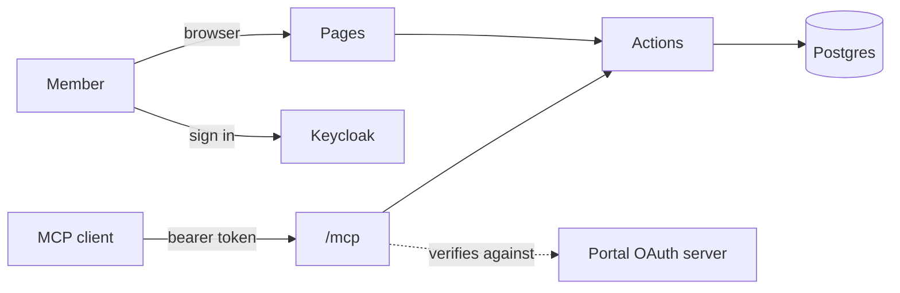

```
██████╗  ██████╗ ██████╗ ████████╗ █████╗ ██╗
██╔══██╗██╔═══██╗██╔══██╗╚══██╔══╝██╔══██╗██║
██████╔╝██║   ██║██████╔╝   ██║   ███████║██║
██╔═══╝ ██║   ██║██╔══██╗   ██║   ██╔══██║██║
██║     ╚██████╔╝██║  ██║   ██║   ██║  ██║███████╗
╚═╝      ╚═════╝ ╚═╝  ╚═╝   ╚═╝   ╚═╝  ╚═╝╚══════╝
```

# WinLab Portal

> The lab's internal apps on one Postgres: sign in with Keycloak, and everything you can click is also an MCP tool.

`nextjs` · `postgres` · `docker` · `mcp`

[](https://github.com/NYCU-WinLab/portal/actions) &nbsp;[](https://github.com/NYCU-WinLab/portal/pkgs/container/portal) &nbsp;[](#license)

WinLab members book rooms, file receipts, sign documents and open the lab door through one portal. This is its rewrite: plain Postgres instead of a hosted backend, one app at a time, and every action an agent can call as well as a member can click.

```
> "Who am I on the portal?"
  ⚡ whoami {}
✓ { "name": "王小明", "username": "ming", "email": "ming@example.com" }
```

## What it does

- **Signs members in** with the lab's Keycloak (OIDC); there are no passwords here.
- **Defines each action once**: a page and its MCP tool run the same code, so neither can drift.
- **Serves MCP** at `/mcp`, with Keycloak as the OAuth 2.1 authorization server.
- **Keeps members' SSH keys** and hands each lab service the keys of the members allowed into it; see [ssh-keys/README.md](ssh-keys/README.md).

## Deploy

With Docker Compose, on any machine with Docker:

```sh
curl -fsSLO https://raw.githubusercontent.com/NYCU-WinLab/portal/main/compose.yaml
curl -fsSL -o .env https://raw.githubusercontent.com/NYCU-WinLab/portal/main/.env.example
# set POSTGRES_PASSWORD, BETTER_AUTH_URL, BETTER_AUTH_SECRET and the KEYCLOAK_* keys in .env
docker compose up -d
```

This starts Postgres, runs the migrations once, then serves the portal from `ghcr.io/nycu-winlab/portal` on `127.0.0.1:3000`.

> [!IMPORTANT]
> Put a reverse proxy with TLS in front, at the host in `BETTER_AUTH_URL`. MCP clients only accept an HTTPS resource, and the Keycloak redirect URI must match it.

portal.winlab.tw deploys on every push to `main`. The release workflow pushes the image, then sends a Carrel app release (`winfra/portal`). On the machine, carrel-deployd runs [deploy/carrel-start.sh](deploy/carrel-start.sh): it sets `PORTAL_VERSION` in `/opt/winlab-portal/.env` and waits until web is healthy. A failed health check rolls back to the previous release. The app unit has a drop-in with `Type=notify`, `NotifyAccess=all` and `TimeoutStartSec=300`, so the check waits for the new container.

## Use

1. In your Keycloak realm, create a confidential OpenID Connect client with the redirect URI `<BETTER_AUTH_URL>/api/auth/callback/keycloak`, and put its ID and secret in `.env`.
2. Open `BETTER_AUTH_URL` and sign in.
3. Make the first portal admin, once, after that member has signed in (later admins are added on /admins):

   ```sh
   docker compose exec postgres psql -U portal -d portal -c \
     "insert into admins (user_id, app) select id, 'portal' from users where username = '<their account>'"
   ```

4. For MCP, create a public OpenID Connect client in the same realm (`portal-mcp`): standard flow with PKCE S256, the redirect URIs `http://localhost:3118/callback` and `https://claude.ai/api/mcp/auth_callback`, and an audience mapper that adds `<BETTER_AUTH_URL>/mcp` to the access token. [NYCU-WinLab/pki](https://github.com/NYCU-WinLab/pki) `keycloak/apply-mcp-client.sh` does this from a JSON file.
5. Sign in on the website once, so your account exists here. Then add the MCP server to a client, for example `claude mcp add --transport http portal <BETTER_AUTH_URL>/mcp --client-id portal-mcp --callback-port 3118`, and ask it to call `whoami`. In claude.ai, choose "use your own OAuth client" and enter `portal-mcp`.

## Configure

Set these in `.env`; [.env.example](.env.example) documents every one.

| Key | What it sets | Default |
|-----|--------------|---------|
| `POSTGRES_PASSWORD` | The database password, used by every service | required |
| `BETTER_AUTH_URL` | The public URL; the MCP resource is `<url>/mcp` | required |
| `BETTER_AUTH_SECRET` | Signs sessions and OAuth queries; also the source of the key for the account-application mail rate-limit log (only the hash of the address is stored), so rotating it also resets that rate-limit history | required |
| `KEYCLOAK_ISSUER` | The realm URL, e.g. `https://auth.example.com/realms/lab` | required |
| `KEYCLOAK_CLIENT_ID`, `KEYCLOAK_CLIENT_SECRET` | The portal's Keycloak client | required |
| `KEYCLOAK_PROVISIONER_CLIENT_ID`, `KEYCLOAK_PROVISIONER_CLIENT_SECRET` | The `portal-provisioner` Keycloak client that creates accounts after approval. The provisioning worker starts only when both are set | unset (no provisioning) |
| `KEYCLOAK_MCP_CLIENT_ID` | The public client MCP tokens must be issued to | `portal-mcp` |
| _(not env)_ apply-site URL | The address account-application mails link to is a setting, not env: after deploy, a portal or accounts admin sets it with `set_apply_site_url` (MCP); until then applicant mails fail with 「申請網站網址尚未設定」. Old `APPLY_SITE_URL` and `APPLICATION_HASH_SECRET` lines in `.env` can be deleted | set after first deploy |
| `PORTAL_VERSION` | Image tag | `main` |
| `PORTAL_BIND`, `PORTAL_PORT` | Where web listens on the host | `127.0.0.1`, `3000` |
| `OTEL_EXPORTER_OTLP_ENDPOINT` | OTLP/HTTP endpoint for traces and error logs; off when empty | empty |

## How it works



Keycloak proves who a member is; the portal keeps its own session and is the authorization server for MCP, so the lab-wide realm never opens client registration. An MCP token carries the member's id and acts with exactly their permissions. Only `lib/actions`, `lib/auth` and `lib/db` may touch the database, and CI checks that every action is in the registry the MCP tools are built from.

### Account provisioning and retention

After a processor approves an application, a background worker in the server process provisions it in four steps, creating the account as the `portal-provisioner` client:

1. `create_account`: creates a disabled user in `/provisioning`, then adds it to `/lab-member/<status>` and `/lab-member/<cohort>`.
2. `join_mail_groups`: adds the address to the Google groups.
3. `activate_and_mail`: enables the user; Keycloak sends the set-password mail, valid 7 days.
4. `finish`: removes the user from `/provisioning`, marks the application accepted, and sends the approved mail (with the forgot-password link) and the notifiee mail.

Each step retries on its own, and the review page shows the progress and a retry. After `finish` the portal never touches the account: a password reset goes through Keycloak's forgot-password page, and the portal no longer tracks or resends the set-password mail.

The provisioner has no realm-management roles, only FGAP v2 group permissions: on `/provisioning` view, view-members, manage-members, manage-membership and manage-membership-of-members; on each `/lab-member/*` subgroup view and manage-membership. It cannot search users or touch existing members; reads go through the read-only `portal` client. **Each year, add the new cohort group (e.g. `/lab-member/118`) to the provisioner's manage-membership permission**: it does not inherit to subgroups, and until then `create_account` blocks the run and names the group in its blocked message. `scripts/keycloak-test-realm.ts` and `scripts/keycloak-probe.ts` set up and probe a disposable local Keycloak (manual tools, never run against production).

An hourly retention job (also in the server process) deletes applications left unverified for 24 hours and used verify tokens, auto-rejects applications 14 days past their change deadline, purges personal data 90 days after an application closes, deletes the mail log after 2 days, and at 09:00 Taipei sends a digest (a count only) of applications pending over 3 days. Each item runs in its own transaction with `skip locked`, so it never waits on a processor.

## Develop

```sh
bun install
cp .env.example .env.local   # point DATABASE_URL at a local Postgres
bun run db:migrate
bun run dev
```

CI runs typecheck, lint, format, the design token check, the action registry check and a build, then builds the image and probes a real `docker compose up`. Schema changes go through `bun run db:generate`; see [CLAUDE.md](CLAUDE.md) for the conventions.

## Limitations

- Only the sign-in, member record and MCP surface exist so far; the apps move over from portal.winlab.tw one at a time.
- One instance: DPoP replay records are in Postgres, but nothing else has been tried with more than one web container.

## Contributing

Issues and PRs welcome: start with [CONTRIBUTING.md](https://github.com/zyx1121/.github/blob/main/CONTRIBUTING.md).

## License

[MIT](LICENSE) · made in a lab whose door has its own MCP tool
